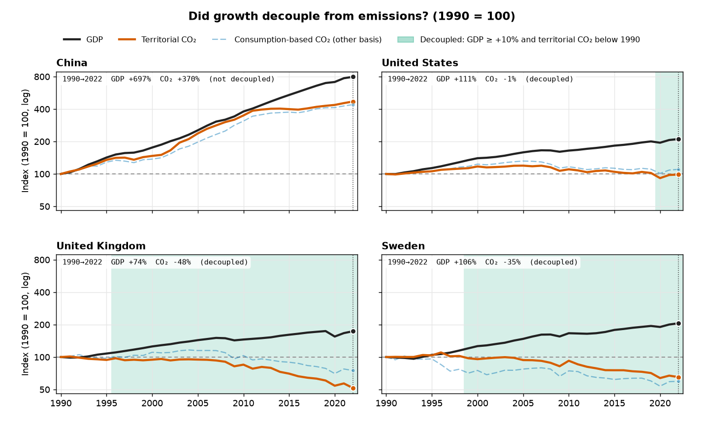
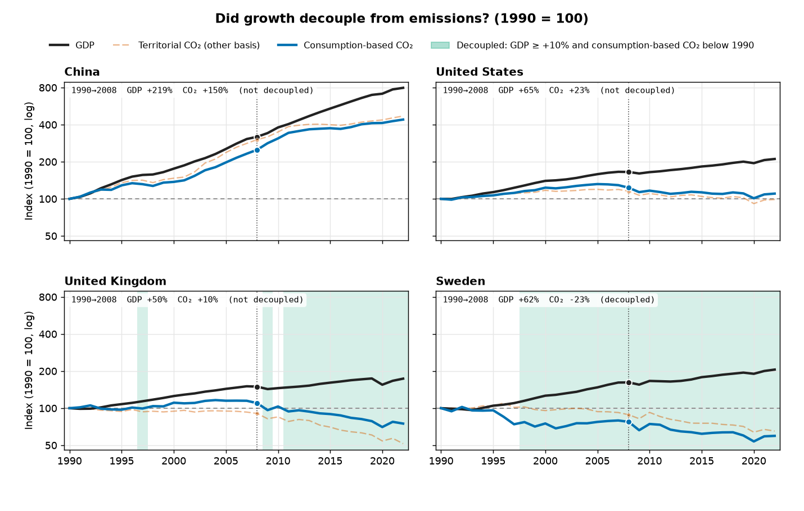
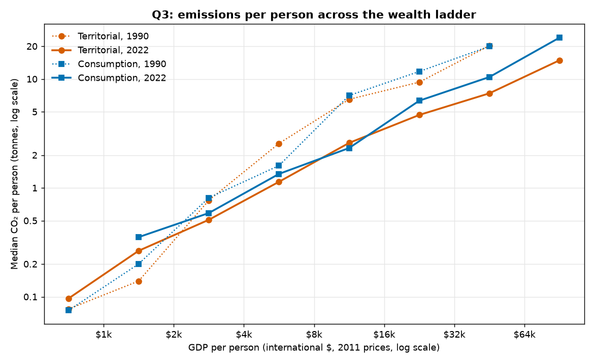

# View C: decoupling chart and derived metrics (Shivam Rastogi)

This branch (`shivam-view-decoupling`) adds Shivam's part of the project:

- the **derived metrics** shared component;
- **View C**, the indexed decoupling chart;
- the **findings for questions 1 and 3**.

Nothing owned by other team members was changed. The new code reuses `selection.py` (Madhav), `data_minimal.py` (Madhav) and `ControlBar` from `main_b.py` (Madhav) without modifying them.

## Files added

| File | What it is |
|---|---|
| `metrics.py` | Shared component: indexing to 1990, growth rates, decoupling flags and the Q1 summary. Pure pandas, no GUI code |
| `views/decoupling_view.py` | View C: `DecouplingPanel`, which follows the `BaseView` contract (`draw(df)` and `update_view(state)`) |
| `main_c.py` | Stand-alone window for View C, with the shared control bar and a `--screenshot` option |
| `tests/test_metrics.py` | Tests for `metrics.py`: hand-made toy data plus checks against the real data |
| `tests/test_part_c.py` | Headless tests for View C |
| `scripts/findings_c.py` | Regenerates every number and figure for Q1 and Q3 |
| `docs/view_c/` | Screenshots, findings (`findings.md`) and the CSV tables it produced |

## How to run

```bash
pip install -r requirements.txt
python scripts/download_data.py                     # fills data/raw/
D=data/raw

# View C window (the --select, --basis and --year flags are optional)
python main_c.py -i $D/owid-co2-data.csv -m $D/ne_50m_admin_0_countries.geojson --select GBR,SWE,USA,CHN

# tests
python tests/test_metrics.py $D/owid-co2-data.csv $D/ne_50m_admin_0_countries.geojson
QT_QPA_PLATFORM=offscreen python tests/test_part_c.py $D/owid-co2-data.csv $D/ne_50m_admin_0_countries.geojson

# findings and screenshots
python scripts/findings_c.py -i $D/owid-co2-data.csv -m $D/ne_50m_admin_0_countries.geojson -o docs/view_c
```

## Step 1: Derived metrics (`metrics.py`)

`add_metrics(df)` takes the shared tidy table and returns a copy with these columns added:

| Column | Meaning |
|---|---|
| `gdp_idx`, `co2_idx`, `cons_co2_idx`, `gdp_pc_idx`, `co2_pc_idx`, `cons_co2_pc_idx` | Each series indexed to its 1990 value = 100. NaN when the country has no 1990 value |
| `gdp_cagr`, `co2_cagr`, `cons_co2_cagr` | Compound annual growth since 1990 (0.02 means 2 % per year) |
| `gdp_yoy`, `co2_yoy`, `cons_co2_yoy` | Growth over the previous year |
| `decoupled_terr`, `decoupled_cons`, `decoupled_both` | Absolute decoupling flags (rule below) |

`decoupling_summary(df, year)` returns one row per country with its decoupling class on each basis and a Q1 category:

- decoupled on both bases;
- territorial only;
- consumption only;
- not decoupled;
- no consumption estimate.

**Decoupling rule.** This rule is used throughout the project and should be quoted in the report:

> A country is absolutely decoupled in year *Y* if its GDP is at least **10 % above 1990** and its CO₂ is **below its 1990 level**.

- The 10 % threshold stops a stagnant economy with falling emissions from counting as decoupled. It is set by `MIN_GDP_GROWTH` in `metrics.py`.
- The rule uses totals, not per-person values, because the climate is affected by total emissions.
- *Relative* decoupling means CO₂ rose, but more slowly than GDP.

## Steps 2 and 3: View C (`views/decoupling_view.py`)



- **Small multiples.** There is one panel per selected country, up to 4. Each panel shows GDP, territorial CO₂ and consumption-based CO₂, indexed to 1990 = 100.
  - The y-axis is shared and logarithmic, so the same percentage change looks the same in every panel (+100 % and −50 % sit the same distance from 100).
  - A dashed reference line marks 100.
- **Selection.** The view follows the shared selection and shows the 4 most populous selected countries.
  - If more than 4 are selected, a note reports "+N more".
  - Countries without a 1990 baseline are listed in a note rather than silently dropped.
  - With nothing selected, it shows example countries (UK, US, Germany, China). If a continent filter is set, it shows that continent's 4 largest economies instead.
- **Basis toggle.** The active basis line is drawn bold. The other basis stays visible but faded and dashed, because the gap between the two CO₂ lines is the point of this view. The legend says which basis is active.
- **Shading.** Green bands mark the years in which the country is decoupled on the active basis. In the screenshot below, the UK's decoupled period starts much later on a consumption basis.
- **Year slider and play.** A dotted marker line and dots on each series follow the year.
  - A box in each panel shows the change since 1990, for example "1990→2008 GDP +50% CO₂ +10% (not decoupled)".
  - A year change only updates these artists. The panels are rebuilt only when the countries or the basis change, which keeps the animation at about 60 ms per frame.
- **Tooltip.** Hovering over a panel shows the nearest year with:
  - each index and its raw value (GDP per person, tonnes CO₂ per person on each basis);
  - population;
  - the decoupling status.

  This is a local tooltip for now. It should be swapped for Tanisha's shared tooltip component once that lands.
- **Colours.** Okabe-Ito colours, the same colour-blind-safe family as View B.



## Step 4: Findings for Q1 and Q3

The full write-up is in [`findings.md`](findings.md). The headline results for 1990→2022:

- **Q1.** Of the 117 countries with both measures, 37 decoupled on the official territorial basis, but only 26 still do on a consumption basis.
  - For 11 countries, including the **United States, Switzerland and Belgium**, the cut disappears once imports are counted.
  - The 26 that hold on both bases are mostly European, for example the UK, Germany, Sweden, Denmark and France, plus Japan.
  - Even in these countries the consumption-based cut is usually smaller (UK: −48 % territorial vs −25 % consumption).
- **Q3.** The answer depends on the comparison:
  - **Across countries** in 2022, median CO₂ per person keeps rising with wealth on both bases. Richer bands emit more.
  - **Within rich countries** (above $32k per person), most have peaked and fallen: 34 of 36 on a territorial basis and 31 of 35 on a consumption basis are more than 10 % below their peak.
  - Consumption-based emissions peaked later (median year 2005, against 1998 for territorial).
  - The answer is therefore "emissions rise with wealth, then level off and fall", with the fall arriving later and smaller once trade is included.



## Still to do, outside this branch
- **Main window.** Plug `DecouplingPanel(model)` into the combined five-view window. It needs only the shared model and `panel.draw(add_metrics(df))`; the view calls `add_metrics` itself if the columns are missing.
- **Data pipeline.** When Saanvi's `data.py` replaces `data_minimal.py`, nothing here should need to change as long as the column names stay the same.
- **Tooltip.** Replace the local tooltip with the shared one from Tanisha.
- **Report.** Write the section on View C, using the design notes and screenshots above.
