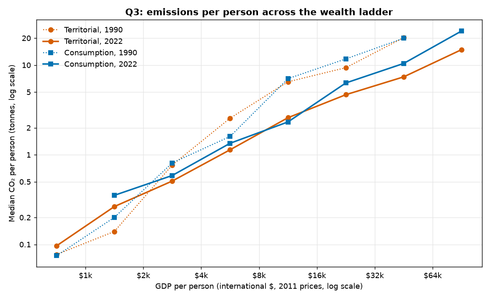

# View C findings: questions 1 and 3

Generated by `scripts/findings_c.py` from the shared table and `metrics.py`.
Decoupling rule: GDP at least 10% above 1990 **and** CO₂ below its
1990 level (absolute decoupling, totals, 1990→2022).

## Q1: Who grew richer while cutting emissions, and does it hold on a consumption basis?

| Category (2022) | Countries |
|---|---|
| Decoupled on both bases | 26 |
| Territorial only (cut partly moved abroad) | 11 |
| Consumption only | 1 |
| Not decoupled | 79 |
| No consumption estimate | 46 |

* Of the 117 countries with both measures, **37** decoupled on the
  official (territorial) basis, but only **26** still qualify on a consumption basis.
* **11 countries' cuts disappear on a consumption basis** (decoupled territorially,
  not on consumption): Belarus, Malta, Belgium, Switzerland, Croatia, Zimbabwe, Albania, Azerbaijan, Armenia, Tajikistan, United States.
* On median, the consumption-based index of territorially-decoupled countries is
  **12 index points** higher than the territorial one,
  i.e. part of their reported cut was moved abroad.

### Decoupled on both bases (defensible list)
| country | continent | gdp_change_% | terr_co2_change_% | cons_co2_change_% |
|---|---|---|---|---|
| Estonia | Europe | 48.0 | -68.0 | -53.0 |
| Latvia | Europe | 22.0 | -66.0 | -32.0 |
| Lithuania | Europe | 66.0 | -64.0 | -47.0 |
| Romania | Europe | 294.0 | -61.0 | -50.0 |
| Slovakia | Europe | 131.0 | -49.0 | -47.0 |
| United Kingdom | Europe | 74.0 | -48.0 | -25.0 |
| Denmark | Europe | 98.0 | -45.0 | -13.0 |
| Czechia | Europe | 135.0 | -42.0 | -27.0 |
| Kyrgyzstan | Asia | 26.0 | -39.0 | -6.0 |
| Bulgaria | Europe | 74.0 | -39.0 | -32.0 |
| Luxembourg | Europe | 157.0 | -38.0 | -33.0 |
| Hungary | Europe | 167.0 | -38.0 | -29.0 |
| Germany | Europe | 94.0 | -36.0 | -30.0 |
| Finland | Europe | 69.0 | -36.0 | -41.0 |
| Sweden | Europe | 106.0 | -35.0 | -40.0 |
| Russia | Europe | 103.0 | -34.0 | -38.0 |
| Greece | Europe | 63.0 | -31.0 | -23.0 |
| France | Europe | 63.0 | -25.0 | -10.0 |
| Italy | Europe | 45.0 | -23.0 | -18.0 |
| Netherlands | Europe | 114.0 | -22.0 | -10.0 |
| Poland | Europe | 296.0 | -16.0 | -8.0 |
| Slovenia | Europe | 93.0 | -16.0 | -4.0 |
| Japan | Asia | 29.0 | -11.0 | -12.0 |
| Portugal | Europe | 73.0 | -10.0 | -5.0 |
| Jamaica | North America | 41.0 | -7.0 | -12.0 |
| Austria | Europe | 92.0 | -2.0 | -6.0 |

### Territorial only (cut partly moved abroad)
| country | continent | gdp_change_% | terr_co2_change_% | cons_co2_change_% |
|---|---|---|---|---|
| Belarus | Europe | 50.0 | -47.0 | 4.0 |
| Malta | Europe | 284.0 | -27.0 | 391.0 |
| Belgium | Europe | 79.0 | -26.0 | 71.0 |
| Switzerland | Europe | 139.0 | -25.0 | 44.0 |
| Croatia | Europe | 75.0 | -23.0 | 19.0 |
| Zimbabwe | Africa | 18.0 | -21.0 | 15.0 |
| Albania | Europe | 179.0 | -21.0 | 0.0 |
| Azerbaijan | Asia | 229.0 | -20.0 | 28.0 |
| Armenia | Asia | 22.0 | -19.0 | 34.0 |
| Tajikistan | Asia | 100.0 | -15.0 | 144.0 |
| United States | North America | 111.0 | -1.0 | 10.0 |

Full table: `q1_decoupling_2022.csv`.

## Q3: As countries get richer, do emissions per person keep rising, level off or fall?

Median CO₂ per person (tonnes) by GDP-per-person band (bands with fewer than
3 countries are left blank):

| gdp_bin | countries 2022 | consumption 1990 | consumption 2022 | territorial 1990 | territorial 2022 |
|---|---|---|---|---|---|
| < $1k | 6 | 0.1 |  | 0.1 | 0.1 |
| $1k-$2k | 15 | 0.2 | 0.3 | 0.1 | 0.3 |
| $2k-$4k | 19 | 0.8 | 0.6 | 0.8 | 0.5 |
| $4k-$8k | 21 | 1.6 | 1.3 | 2.6 | 1.1 |
| $8k-$16k | 36 | 7.1 | 2.3 | 6.5 | 2.6 |
| $16k-$32k | 31 | 11.7 | 6.3 | 9.3 | 4.7 |
| $32k-$64k | 32 | 19.9 | 10.4 | 20.2 | 7.4 |
| > $64k | 4 |  | 24.0 |  | 14.9 |

Within rich countries (GDP > $32k per person in 2022):
* **34 of 36** have territorial CO₂ per person more than 10 % below a peak
  reached before 2017.
* On a consumption basis **31 of 35** do.
* Median peak year: territorial **1998**, consumption
  **2005**.

Full tables: `q3_wealth_curve.csv`, `q3_rich_country_peaks.csv`.
